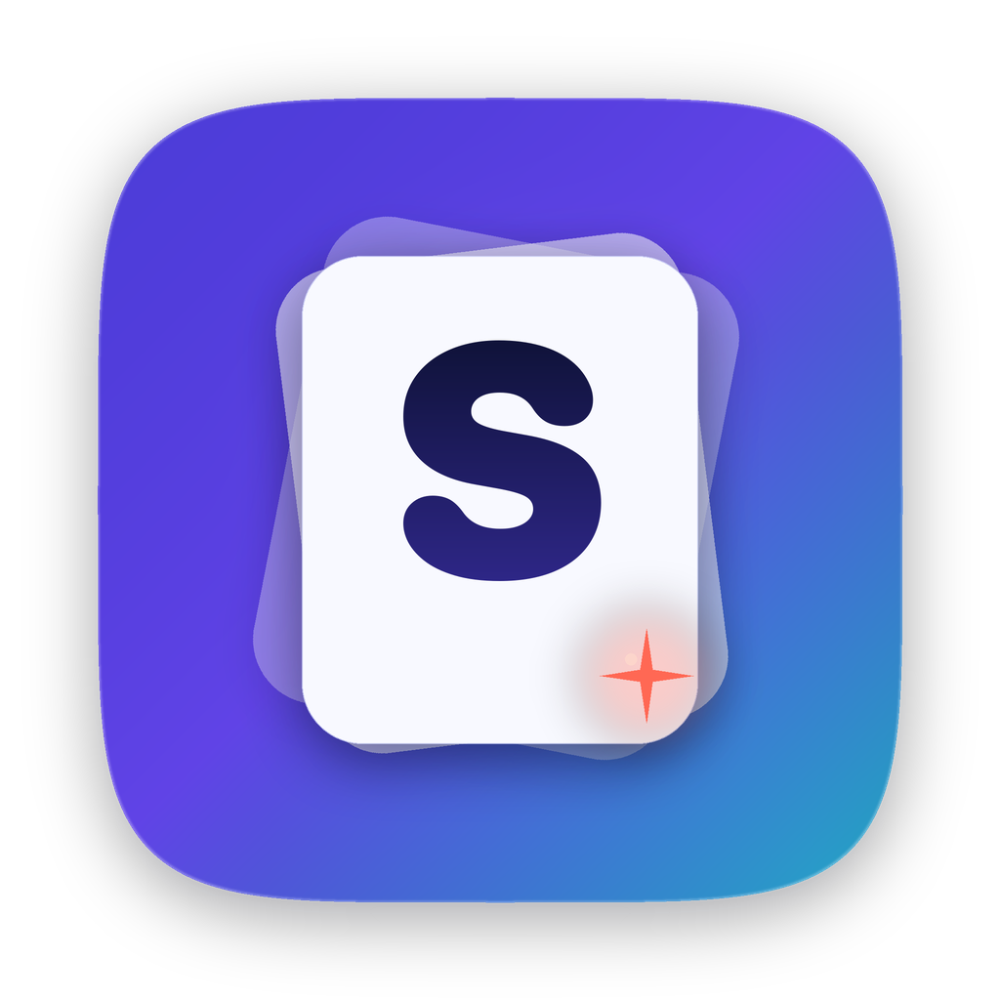
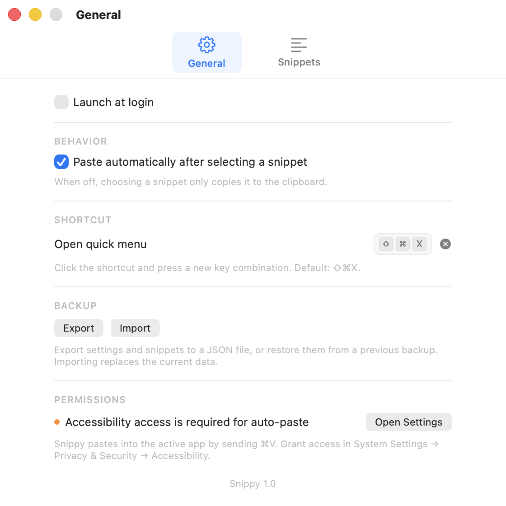
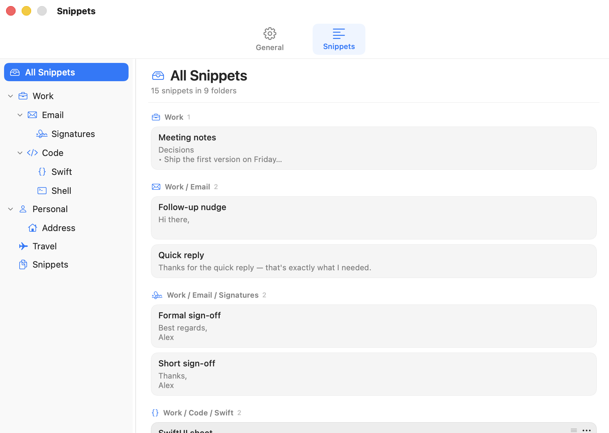
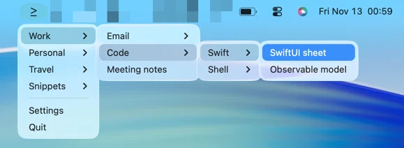

<p align="center">
  
</p>

<h1 align="center">Snippy</h1>

<p align="center">
  A small, native snippet manager for macOS that lives in your menu bar.
</p>

Snippy keeps reusable text one click away. Click the menu bar icon, choose a snippet, and it is copied and pasted into
the app you were using. Groups can be nested as deeply as you need, and the full editor lives in Settings.

## Screenshots

|                             General                             |                             Snippets                              |
|:---------------------------------------------------------------:|:----------------------------------------------------------------:|
|  |  |

<p align="center">
  
</p>

*Screenshots use the built-in demo data (`--demo`).*

## Features

- Native menu bar quick menu with recursive groups and plain-text snippets.
- Configurable global shortcut (default ⇧⌘X) for the quick menu.
- All Snippets view with snippets grouped by folder, plus a folder sidebar.
- Custom SF Symbols for folder icons.
- Hidden snippets for passwords — masked in previews and cleared from the clipboard after pasting.
- Paste automatically or copy only; drag to reorder and move items.
- Launch at login and Accessibility status.
- Import/export of settings and snippets as a JSON backup.
- Local sandboxed SwiftData storage. No accounts, analytics or network.

## Requirements

- macOS 26.2 or newer
- Xcode 26.4 or newer

## Build and run

### Command line

```sh
make            # Debug build → ./snippy.app
make run        # Build and launch
make release    # Release build → ./snippy.app
make test       # Debug build and SwiftData self-test
make clean      # Remove ./snippy.app and build/
```

Each build uses `build/` as temporary DerivedData, copies the finished app to
`./snippy.app`, and removes the staging directory. Without a development team,
Xcode signs the app to run locally (ad-hoc). To use your team:

```sh
make DEVELOPMENT_TEAM=YOUR_TEAM_ID
```

`make release` is a local Release build; distribution builds need Developer ID
signing and notarization (see below).

### Xcode

Open `snippy.xcodeproj`, select the **snippy** scheme, choose your development
team under **Signing & Capabilities**, and run. The repository intentionally
does not commit a team ID.

### Distribution

A build for other Macs should be signed with a **Developer ID Application**
certificate (Apple Developer Program membership required) and notarized. Archive
with your team ID:

```sh
xcodebuild -project snippy.xcodeproj -scheme snippy -configuration Release \
  -archivePath build/Snippy.xcarchive DEVELOPMENT_TEAM=YOUR_TEAM_ID archive
```

Export the archive from Xcode Organizer (**Distribute App → Developer ID**) or
with `xcodebuild -exportArchive`, then notarize and staple the app:

```sh
ditto -c -k --keepParent Snippy.app Snippy.zip
xcrun notarytool submit Snippy.zip --keychain-profile AC_PASSWORD --wait
xcrun stapler staple Snippy.app
```

Create the `AC_PASSWORD` keychain profile once with
`xcrun notarytool store-credentials`. Attach the notarized `.dmg` or `.zip` to a
[GitHub Release](https://github.com/raorudzhov/snippy/releases).

## Usage

On first launch Snippy opens Settings. Create a group in **Snippets**, then use
the **≥** menu bar icon or **⇧⌘X** to paste snippets.

- Click a snippet in the quick menu to copy it. With **Paste automatically**
  enabled, Snippy also pastes it into the previous app.
- Mark a snippet as **Hidden** in the editor to keep its value out of previews
  and clear it from the clipboard after pasting.
- Press **⇧⌘X** or click the **≥** icon to open the quick menu. The shortcut
  opens it at the mouse pointer; change the shortcut in **General → Shortcut**.
- Choose **All Snippets** to browse every snippet grouped by folder, or select a
  folder in the sidebar.
- Open **Settings** with `⌘,`; jump to the snippets editor with `⌘E`.
- Right-click empty sidebar space for a top-level group, or a group row for one
  inside it.
- Right-click a group or snippet for rename and delete actions.
- Right-click a folder and choose **Customize Icon** to pick any SF Symbol.
- Drag groups and snippets to reorder or move them between groups.
- Drag the divider between the sidebar and editor to resize the sidebar;
  double-click it to reset the width.
- Export or restore settings and snippets from **General → Backup**. Import
  replaces the current data.

## Permissions and data

Pasting into another application requires Accessibility access: enable **Snippy** in **System Settings → Privacy &
Security → Accessibility**. Without it, snippets are still copied to the clipboard.

The app is sandboxed. Its SwiftData store lives at:

```
~/Library/Containers/raorudzhov.snippy/Data/Library/Application Support/Snippy/Snippets.store
```

## Development

Debug builds accept `--self-test`, `--demo`, `--open-settings`,
`--open-manager` and `--snapshot <path>`. `make test` runs the self-test.

## License

MIT — see [LICENSE](LICENSE). Copyright © 2026 Roman Orudzhov.
